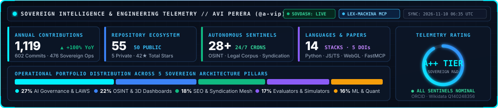
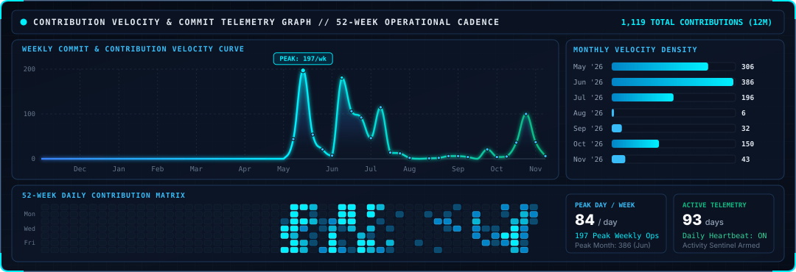
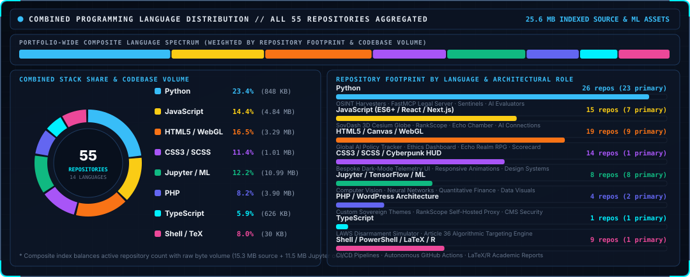
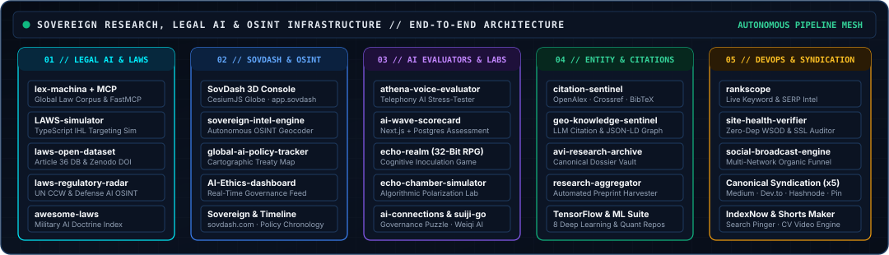

<div align="center">
  

  <br><br>

  <a href="https://aviperera.com">
    
  </a>

  <h1>Hi there 👋, I'm Avi Perera</h1>

  <p>
    <strong>AI Governance &amp; International Humanitarian Law Researcher</strong> · <strong>Lethal Autonomous Weapons Systems (LAWS) Analyst</strong> · <strong>Founder of <a href="https://sovdash.com">SovDash</a></strong>
  </p>

  <a href="https://aviperera.com">
    
  </a>

  <br>

  <!-- Primary Portals & Verified Entity Identifiers -->
  <p>
    <a href="https://aviperera.com"></a>
    <a href="https://app.sovdash.com"></a>
    <a href="https://sovdash.com"></a>
    <a href="https://orcid.org/0009-0005-1903-6868"></a>
    <a href="https://www.wikidata.org/wiki/Q140248356"></a>
    <a href="https://www.researchgate.net/profile/Avi-Perera"></a>
  </p>

  <!-- Social & Broadcast Channels -->
  <p>
    <a href="https://www.linkedin.com/in/avi-perera"></a>
    <a href="https://x.com/aviperera_"></a>
    <a href="https://bsky.app/profile/aviperera.bsky.social"></a>
    <a href="https://instagram.com/aviperera_"></a>
    <a href="https://tiktok.com/@aviperera_"></a>
    <a href="https://aviperera.com/feed/"></a>
  </p>
</div>

---

## 📊 Sovereign Telemetry & Engineering Analytics

<div align="center">
  
  <br><br>
  
  <br><br>
  
</div>

---

## 🔬 Research Mandate, Affiliations & Scholarly Monographs

| 🎯 Core Research & Engineering Focus | 🏛️ Institutional Affiliations & Academic Lineage |
| :--- | :--- |
| **🎯 Lethal Autonomous Weapons Systems (LAWS):** Defining operational parameters of *Meaningful Human Control (MHC)*, human-in/on-the-loop targeting latency, and loitering munition autonomy.<br><br>**⚖️ International Humanitarian Law (IHL):** Algorithmic targeting compliance under Additional Protocol I (Article 36 weapon reviews, distinction, proportionality, and precaution).<br><br>**🛰️ Geopolitical OSINT & Treaty Telemetry:** Real-time 3D cartographic monitoring of defence AI deployments, UN CCW GGE negotiations, and state accountability via **SovDash**.<br><br>**🧠 Legal AI & Knowledge Graph Infrastructure:** Model Context Protocol (`MCP`) legal servers, Generative Engine Optimization (`GEO`), and autonomous scholarly citation sentinels. | 🇺🇳 **United Nations Institute for Disarmament Research (UNIDIR)** — *Research & Policy Engagement*<br><br>🛑 **Campaign to Stop Killer Robots** — *International Disarmament Advocacy & Simulation Tooling*<br><br>🎓 **University of Cambridge** — *Academic Lineage*<br><br>⚖️ **University of Buckingham** — *Law & International Studies*<br><br>🏢 **Sovereign Intelligence (`SovDash`)** — *Founder & Principal Systems Architect* |

### 📄 Selected Peer & Working Papers (DOI-Indexed)

| Year | Publication / Monograph | Domain | Identifier / Access |
| :---: | :--- | :--- | :---: |
| **2025** | **[The Algorithmic Reshaping of Radicalisation Pathways](https://www.researchgate.net/doi/10.13140/RG.2.2.15350.92489)** | Algorithmic Extremism & Cognitive Security | [](https://www.researchgate.net/doi/10.13140/RG.2.2.15350.92489) |
| **2025** | **[Weapons That Think Must Not Decide (UNIDIR Poster)](https://www.researchgate.net/doi/10.13140/RG.2.2.10288.67842)** | LAWS, Meaningful Human Control & UN Disarmament | [](https://www.researchgate.net/doi/10.13140/RG.2.2.10288.67842) |
| **2025** | **[Why Do States Comply With International Agreements?](https://www.researchgate.net/doi/10.13140/RG.2.2.12596.31360)** | Public International Law & Treaty Enforcement | [](https://www.researchgate.net/doi/10.13140/RG.2.2.12596.31360) |
| **2025** | **[The Myth of the "Third World": Language of Empire](https://www.researchgate.net/doi/10.13140/RG.2.2.15112.89603)** | Post-Colonial International Law & Geopolitics | [](https://www.researchgate.net/doi/10.13140/RG.2.2.15112.89603) |
| **2023** | **[Social Media Impacts on Critical Thinking](https://www.researchgate.net/doi/10.13140/RG.2.2.21829.51684)** | Epistemic Resilience & Attention Economics | [](https://www.researchgate.net/doi/10.13140/RG.2.2.21829.51684) |

---

## 🛰️ Sovereign Ecosystem Architecture & Flagship Production Systems

<div align="center">
  
</div>

<br>

### 🏆 Flagship Platforms, Legal AI Servers & Interactive Simulators

| System / Repository | Architecture & Stack | Operational Capability & Live Deployment |
| :--- | :---: | :--- |
| 📡 **[Sovereign Intelligence Dashboard](https://github.com/a-vip/Sovereign_Intelligence_Dashboard)** | `Next.js` `React` `CesiumJS` `WebGL` | Real-time 3D globe threat-intelligence (OSINT/SIGINT) telemetry console with live RSS/GDELT ingestion, military flight/vessel overlays, and regional instability indices. **[🚀 Launch Console (`app.sovdash.com`)](https://app.sovdash.com)** |
| ⚖️ **[Lex Machina — Global Law Corpus & MCP](https://github.com/a-vip/lex-machina)** | `Python` `FastMCP` `Git Corpus` `CI/CD` | Self-updating Git repository and stateless Model Context Protocol (`MCP`) server indexing global AI regulations, cyber statutes, and international treaties for AI agents. Companion: **[`lex-machina-skills`](https://github.com/a-vip/lex-machina-skills)** |
| 🎯 **[LAWS Simulator](https://github.com/a-vip/LAWS-simulator)** | `TypeScript` `React` `Vite` `IHL Engine` | Interactive Lethal Autonomous Weapons Systems targeting & Article 36 compliance simulator built for the **Campaign to Stop Killer Robots** and UN disarmament advocacy. |
| 🌍 **[Global AI Policy Tracker](https://github.com/a-vip/global-ai-policy-tracker)** | `HTML5` `JavaScript` `Interactive Map` | Responsive cartographic regulatory intelligence platform mapping national AI legislation, military AI declarations, and binding international frameworks. **[🌐 View Live Tracker](https://aviperera.com/ai-policy-tracker/)** |
| 📚 **[Global LAWS Open Dataset](https://github.com/a-vip/laws-open-dataset)** | `Python` `JSON/CSV` `Zenodo DOI` `CC-BY-4.0` | Open-access structured database of autonomous weapon systems, loitering munitions, sensor-to-shooter autonomy profiles, and IHL Article 36 review benchmarks. |
| 🛰️ **[Sovereign Intel Engine](https://github.com/a-vip/sovereign-intel-engine)** | `Python` `OSINT` `NLP Geocoder` `Cron` | Autonomous high-fidelity threat intelligence harvester, geopolitical entity geocoder, and automated strategic briefing compiler powering the SovDash ecosystem. |
| 🎙️ **[Athena Voice Bot Evaluator](https://github.com/a-vip/athena-voice-evaluator)** | `Python` `Voice AI` `Telephony` `LLM Eval` | Autonomous AI patient simulator and multi-persona adversarial stress-testing framework for evaluating healthcare voice bots and clinical telephony agents. |
| 📊 **[AI Wave Scorecard](https://github.com/a-vip/ai-wave-scorecard)** | `Next.js` `PostgreSQL` `SVG` `Audio TTS` | Full-stack AI readiness and meta-learning self-assessment platform featuring custom Next.js API routes, Postgres persistence, dynamic SVG animations, and voice narration. |
| 🔍 **[RankScope — Keyword Intelligence](https://github.com/a-vip/rankscope)** | `JavaScript` `Node.js` `PHP` `SEO API` | Self-hosted live keyword intelligence suite delivering real-time trend discovery, long-tail expansion, measured SERP difficulty, personal rankability, and evidence-backed content briefs. |
| ⚡ **[Site Health Verifier](https://github.com/a-vip/site-health-verifier)** | `Python` `Zero-Dep` `GitHub Actions` `SSL` | Zero-dependency pre/post-deployment health auditor, silent CMS crash detector (WordPress WSOD, PHP, Django, Node), SSL certificate monitor, and CI/CD uptime verifier. |
| 🎮 **[The Echo Realm: Chronicles of the Archivist](https://github.com/a-vip/echo-realm)** | `HTML5 Canvas` `JavaScript` `32-Bit RPG` | Playable 32-bit action RPG exploring algorithmic radicalization, echo chambers, cognitive inoculation, and Socratic dialogue. **[🕹️ Play Live on GitHub Pages](https://a-vip.github.io/echo-realm/)** |
| 🛡️ **[AI Ethics Intelligence Dashboard](https://github.com/a-vip/AI-Ethics-intelligence-dashboard)** | `HTML5` `JavaScript` `Live RSS Telemetry` | Real-time AI governance, algorithmic safety incident, and regulatory policy telemetry dashboard. **[📡 Open Live Dashboard](https://aviperera.com/ai-ethics-dashboard/)** |

---

## 🗂️ Interactive Repository Explorer (By Operational Domain)

> 💡 *Click any operational domain below to expand the full engineering specification, live workflow badges, and repository links across all 45+ public systems.*

<details open>
<summary><b>⚖️ I. AI Governance, LAWS &amp; International Humanitarian Law Infrastructure (8 Repositories)</b></summary>
<br>

| Repository | Stack | Status / Automation | Description |
| :--- | :---: | :---: | :--- |
| **[`lex-machina`](https://github.com/a-vip/lex-machina)** | `Python` `MCP` |  | Self-updating Global AI, Cyber & International Law Git Corpus + stateless Model Context Protocol (`MCP`) server. |
| **[`lex-machina-skills`](https://github.com/a-vip/lex-machina-skills)** | `FastMCP` `Agent` |  | Lex Machina Pro: Elite legal & regulatory intelligence agent skill suite for Claude Code, Cursor & Windsurf. |
| **[`LAWS-simulator`](https://github.com/a-vip/LAWS-simulator)** | `TypeScript` |  | Interactive Lethal Autonomous Weapons Systems targeting & disarmament advocacy simulator. |
| **[`laws-open-dataset`](https://github.com/a-vip/laws-open-dataset)** | `Python` `Data` |  | Global open-access database of autonomous weapon systems, Article 36 benchmarks & Zenodo DOI registry. |
| **[`laws-regulatory-radar`](https://github.com/a-vip/laws-regulatory-radar)** | `Python` `OSINT` |  | Autonomous OSINT radar monitoring UN CCW GGE negotiations, defence AI doctrine, and regulatory preprints. |
| **[`awesome-autonomous-weapons-systems`](https://github.com/a-vip/awesome-autonomous-weapons-systems)** | `Python` `Docs` |  | Curated taxonomy and scholarly index on military AI doctrine, IHL compliance, and autonomous weapon systems. |
| **[`global-ai-policy-tracker`](https://github.com/a-vip/global-ai-policy-tracker)** | `HTML5` `JS` | **[Live Web App](https://aviperera.com/ai-policy-tracker/)** | Interactive cartographic explorer tracking national AI regulations, treaties, and governance frameworks worldwide. |
| **[`ai-policy-timeline`](https://github.com/a-vip/ai-policy-timeline)** | `HTML5` `JS` |  | Interactive chronological visualization of landmark international AI governance treaties, executive orders, and summits. |

</details>

<details>
<summary><b>🛰️ II. Sovereign OSINT, Threat Intelligence &amp; Command Consoles (5 Repositories)</b></summary>
<br>

| Repository | Stack | Deployment | Description |
| :--- | :---: | :---: | :--- |
| **[`Sovereign_Intelligence_Dashboard`](https://github.com/a-vip/Sovereign_Intelligence_Dashboard)** | `Next.js` `CesiumJS` | **[app.sovdash.com](https://app.sovdash.com)** | Flagship 3D globe OSINT/SIGINT geopolitical intelligence command center with live telemetry and event correlation. |
| **[`sovereign-intel-engine`](https://github.com/a-vip/sovereign-intel-engine)** | `Python` `OSINT` | `Autonomous Cron` | High-fidelity threat intelligence harvester, multi-source RSS/API ingestor, and geopolitical geocoding engine. |
| **[`Sovereign`](https://github.com/a-vip/Sovereign)** | `HTML5` `CSS3` `JS` | **[sovdash.com](https://sovdash.com)** | Sovereign Intelligence marketing platform, product architecture showcase, and enterprise analytics portal. |
| **[`AI-Ethics-intelligence-dashboard`](https://github.com/a-vip/AI-Ethics-intelligence-dashboard)** | `HTML5` `JS` | **[Live Console](https://aviperera.com/ai-ethics-dashboard/)** | Real-time AI ethics, algorithmic accountability, and policy intelligence aggregator dashboard. |
| **[`interactive-cyber-canvas`](https://github.com/a-vip/interactive-cyber-canvas)** | `HTML5 Canvas` `JS` | **[Live Demo](https://htmlpreview.github.io/?https://github.com/a-vip/interactive-cyber-canvas/blob/main/cyber-canvas.html)** | Zero-dependency, 60fps interactive neural network particle and cyber-telemetry HTML5 canvas engine. |

</details>

<details>
<summary><b>🎓 III. Scholarly Impact, Entity Graph (GEO) &amp; Research Archives (4 Repositories)</b></summary>
<br>

| Repository | Stack | Status / Automation | Description |
| :--- | :---: | :---: | :--- |
| **[`academic-citation-sentinel`](https://github.com/a-vip/academic-citation-sentinel)** | `Python` `BibTeX` |  | Automated scholarly impact sentinel querying OpenAlex, Crossref, and Semantic Scholar with BibTeX/CFF generation. |
| **[`geo-knowledge-sentinel`](https://github.com/a-vip/geo-knowledge-sentinel)** | `Python` `JSON-LD` |  | Generative Engine Optimization (`GEO`) validator auditing Schema.org JSON-LD entity graphs and Wikidata (`Q140248356`) authority for LLM citation retrieval. |
| **[`avi-research-archive`](https://github.com/a-vip/avi-research-archive)** | `Python` `Markdown` |  | Canonical open-access Markdown repository archiving military AI dossiers, weapon system profiles, and governance essays. |
| **[`ai-governance-research-aggregator`](https://github.com/a-vip/ai-governance-research-aggregator)** | `Python` `arXiv` | `Automated Harvester` | Continuously updated academic preprint and policy paper aggregator focused on AI governance and sovereign algorithms. |

</details>

<details>
<summary><b>🧠 IV. AI Safety Evaluators, Cognitive Security Labs &amp; Interactive Simulations (7 Repositories)</b></summary>
<br>

| Repository | Stack | Type / Access | Description |
| :--- | :---: | :---: | :--- |
| **[`athena-voice-evaluator`](https://github.com/a-vip/athena-voice-evaluator)** | `Python` `Voice AI` | `Evaluation Suite` | Automated AI patient simulator and adversarial telephony stress-testing harness for healthcare voice bots. |
| **[`ai-wave-scorecard`](https://github.com/a-vip/ai-wave-scorecard)** | `Next.js` `Postgres` | `Full-Stack App` | Interactive AI readiness self-assessment platform with PostgreSQL backend, SVG animations, and voice narration. |
| **[`echo-realm`](https://github.com/a-vip/echo-realm)** | `HTML5` `JS` | **[Playable RPG](https://a-vip.github.io/echo-realm/)** | *The Echo Realm: Chronicles of the Archivist* — 32-bit action RPG teaching cognitive inoculation against algorithmic polarization. |
| **[`echo-chamber-simulator`](https://github.com/a-vip/echo-chamber-simulator)** | `JavaScript` | `Simulation Lab` | Real-time interactive simulation of algorithmic feed dynamics, outrage amplification, and network polarization. |
| **[`ai-connections`](https://github.com/a-vip/ai-connections)** | `JavaScript` | `Cognitive Game` | Daily lateral-thinking taxonomy puzzle for AI Governance, International Law, and Frontier Systems. |
| **[`suiji-go`](https://github.com/a-vip/suiji-go)** | `JavaScript` | `Strategic AI Dojo` | *Suiji (粋碁)* — Modern Go (*Weiqi / Baduk*) strategic analysis platform and interactive AI learning dojo. |
| **[`one-hostel-danang`](https://github.com/a-vip/one-hostel-danang)** | `React` `Vite` `CSS` | `Hospitality App` | Full-featured beachfront reservation engine, guest portal, and digital nomad community platform. |

</details>

<details>
<summary><b>⚡ V. Autonomous SEO Intelligence, DevOps Verification &amp; Syndication Mesh (11 Repositories)</b></summary>
<br>

| Repository | Stack | Status / Role | Description |
| :--- | :---: | :---: | :--- |
| **[`rankscope`](https://github.com/a-vip/rankscope)** | `JavaScript` `PHP` |  | Self-hosted live keyword intelligence engine with trend discovery, difficulty scoring, and evidence-backed content briefs. |
| **[`site-health-verifier`](https://github.com/a-vip/site-health-verifier)** | `Python` `CLI` |  | Zero-dependency pre/post-deployment health auditor, silent CMS crash detector (WSOD), and SSL/uptime verifier. |
| **[`social-broadcast-engine`](https://github.com/a-vip/social-broadcast-engine)** | `Python` `Actions` |  | Autonomous multi-platform social broadcaster and organic research insight distribution funnel. |
| **[`automated-syndicator`](https://github.com/a-vip/automated-syndicator)** | `Python` `WOPE` | `Syndication Core` | Primary "Write Once, Publish Everywhere" (`WOPE`) canonical content syndication and archival backfill engine. |
| **[`pinterest-syndicator`](https://github.com/a-vip/pinterest-syndicator)** | `Python` `Vision` | `12h Cron Engine` | Autonomous visual syndicator and evergreen discovery funnel for research dossiers on `aviperera.com`. |
| **[`medium-canonical-syndicator`](https://github.com/a-vip/medium-canonical-syndicator)** | `Python` `API` | `Canonical Mesh` | Automated Medium syndicator embedding strict `canonicalUrl` attribution back to `aviperera.com`. |
| **[`devto-canonical-syndicator`](https://github.com/a-vip/devto-canonical-syndicator)** | `Python` `API` | `Canonical Mesh` | Automated Dev.to publisher preserving origin domain authority via canonical metadata injection. |
| **[`hashnode-canonical-syndicator`](https://github.com/a-vip/hashnode-canonical-syndicator)** | `Python` `GraphQL` | `Canonical Mesh` | Automated Hashnode GraphQL syndicator with `originalArticleURL` canonical enforcement. |
| **[`indexnow-traffic-booster`](https://github.com/a-vip/indexnow-traffic-booster)** | `Python` `IndexNow` | `Instant Indexing` | Automated IndexNow protocol dispatcher notifying Bing, Yandex, Seznam, and Naver of new research publications. |
| **[`youtube-shorts-maker`](https://github.com/a-vip/youtube-shorts-maker)** | `Python` `OpenCV` | `Media Pipeline` | Automated audio-engagement analyzer, 9:16 vertical video reframer, and dynamic captioning pipeline. |
| **[`activity-sentinel`](https://github.com/a-vip/activity-sentinel)** | `Python` `Actions` | `Daily Telemetry` | Autonomous daily repository heartbeat and contribution consistency sentinel. |

</details>

<details>
<summary><b>🔬 VI. Deep Learning, Computer Vision &amp; Quantitative Data Science Archive (8 Repositories)</b></summary>
<br>

| Repository | Stack | Focus Area |
| :--- | :---: | :--- |
| **[`TensorFlow-Course`](https://github.com/a-vip/TensorFlow-Course)** | `Jupyter` `TensorFlow` | Deep learning computer vision, convolutional neural networks (CNNs), image classification, and synthetic data generation. |
| **[`Python-for-Finance`](https://github.com/a-vip/Python-for-Finance)** | `Jupyter` `Pandas` | Quantitative financial modeling, algorithmic portfolio optimization, time-series econometrics, and Monte Carlo simulations. |
| **[`Machine-Learning-with-Python`](https://github.com/a-vip/Machine-Learning-with-Python)** | `Jupyter` `Scikit-Learn` | Supervised & unsupervised machine learning pipelines, ensemble classifiers, and predictive modeling. |
| **[`Data-Visualization-with-Python`](https://github.com/a-vip/Data-Visualization-with-Python)** | `Jupyter` `Matplotlib` | High-dimensional statistical visualization, geospatial plotting, and exploratory data analysis (`Pandas` / `NumPy`). |
| **[`Visualization-using-Matplotlib`](https://github.com/a-vip/Visualization-using-Matplotlib)** | `Jupyter` `Matplotlib` | Custom scientific figure generation and publication-grade analytical charting workflows. |
| **[`Maths-for-ML`](https://github.com/a-vip/Maths-for-ML)** | `Jupyter` `NumPy` | Linear algebra, multivariate calculus, eigendecomposition, and probabilistic foundations for machine learning. |
| **[`Web-Scraping-using-Python`](https://github.com/a-vip/Web-Scraping-using-Python)** | `Jupyter` `BeautifulSoup` | Automated web data extraction, DOM parsing, and structured dataset cleaning pipelines. |
| **[`R-Resume`](https://github.com/a-vip/R-Resume)** | `TeX` `R Markdown` | Reproducible academic curriculum vitae and technical report typesetting via LaTeX and R Markdown. |

</details>

---

## 📰 Latest Publications & Military AI Dossiers (`aviperera.com`)

> 🔄 *Automatically synchronized daily from **[aviperera.com](https://aviperera.com)** via autonomous GitHub Actions REST/RSS pipeline.*

<!-- BLOG-POST-LIST:START -->
- [V-BAT (MQ-35)](https://aviperera.com/v-bat-mq-35/)
- [Norinco Fuxi and NUDT Combat Humanoids](https://aviperera.com/norinco-fuxi-and-nudt-combat-humanoids/)
- [FEDOR Skybot F-850](https://aviperera.com/fedor-skybot-f-850/)
- [Character.AI’s Bankruptcy Was Foreseeable: What the Collapse of an AI Companion Giant Means](https://aviperera.com/character-ai-bankruptcy/)
- [US Execution Global Online Livestream and Law](https://aviperera.com/hasan-execution-livestream-law/)

<details>
<summary><b>📖 Load More Publications</b></summary>

- [Switchblade 300 and 600 Loitering Munitions](https://aviperera.com/switchblade-300-600/)
- [Abolishing Columbus Day: Genocide and historical reckoning](https://aviperera.com/abolish-columbus-day/)
- [Alex Ballistic-Protected Humanoid (IHMC)](https://aviperera.com/alex-ballistic-protected-humanoid-ihmc/)
- [Foundation Phantom MK-1 and MK-2](https://aviperera.com/foundation-phantom-mk-1-and-mk-2/)
- [ARCV MULE](https://aviperera.com/arcv-mule/)
- [Unitree B2 Combat Mod](https://aviperera.com/unitree-b2-combat-mod/)
- [Dating Apps, Loneliness and the Pipeline to Extremism](https://aviperera.com/dating-apps-loneliness-extremism/)
- [Vision 60 Q-UGV](https://aviperera.com/vision-60-q-ugv/)
- [MQ-9 Reaper](https://aviperera.com/mq-9-reaper/)
- [Abliteration.ai and the End of the Guardrail Assumption: What It Means for International Security](https://aviperera.com/abliteration-ai-removing-guardrails-international-security/)
</details>
<!-- BLOG-POST-LIST:END -->

---

<details>
<summary><b>🏛️ Academic Citation, Entity Graph &amp; Sovereign Verification (BibTeX / ORCID / Wikidata)</b></summary>
<br>

To cite the **Global LAWS Open Dataset**, **Lex Machina Corpus**, or research infrastructure in academic or policy publications:

```bibtex
@misc{perera2026sovereign,
  author       = {Perera, Avi},
  title        = {Sovereign Intelligence \& AI Governance Research Infrastructure},
  year         = {2026},
  publisher    = {GitHub / SovDash},
  journal      = {aviperera.com},
  howpublished = {\url{https://github.com/a-vip}},
  note         = {ORCID: 0009-0005-1903-6868 | Wikidata: Q140248356}
}
```

- **Canonical Knowledge Hub:** [https://aviperera.com](https://aviperera.com)
- **Sovereign OSINT Console:** [https://app.sovdash.com](https://app.sovdash.com)
- **ORCID Registry:** [https://orcid.org/0009-0005-1903-6868](https://orcid.org/0009-0005-1903-6868)
- **Wikidata Entity:** [https://www.wikidata.org/wiki/Q140248356](https://www.wikidata.org/wiki/Q140248356)

</details>

<div align="center">
  <br>
  <sub><b>SOVEREIGN INTELLIGENCE // AVI PERERA (@a-vip)</b> · Autonomous Telemetry &amp; Dossier Sync Powered by GitHub Actions</sub>
</div>
